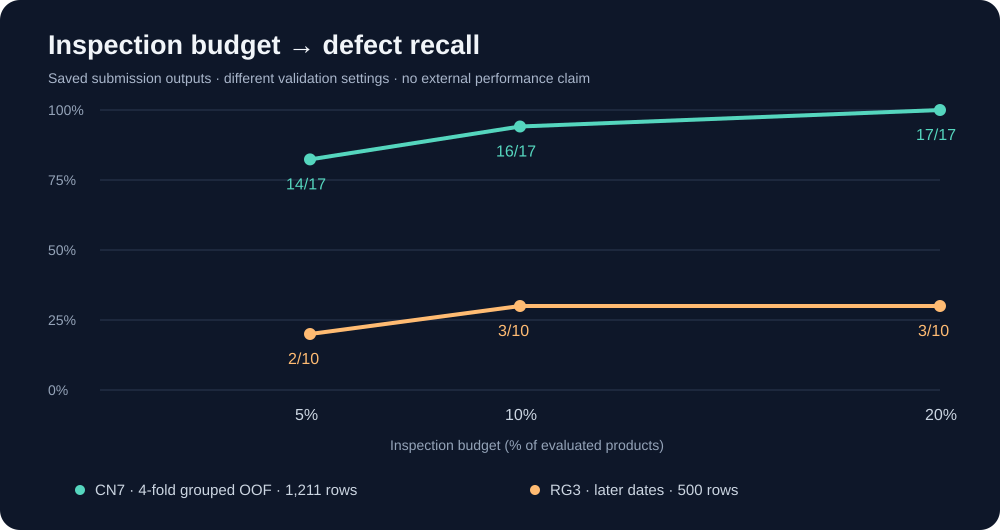

<div align="center">

# KAMP 사출성형 불량 예측과 검사 우선순위

**공정데이터로 먼저 검사할 제품을 찾고, 예측이 어려운 조건을 분석한 프로젝트**

KAMP 제조데이터 분석 경진대회 참여 · 팀 **안영잘부** · 정지혜, 윤효원

**본인 기여(정지혜): 데이터 전처리 및 데이터 분석 전반**

`Python` · `scikit-learn` · `Class Imbalance` · `Manufacturing Data`

[결과보고서](docs/KAMP_report.pdf) · [검증 노트북](notebooks/01_validation.ipynb) · [예측 노트북](notebooks/02_prediction.ipynb) · [실험 비교](docs/experiments.md)

</div>

## 프로젝트 요약

제품 불량이 드문 제조 데이터에서는 정확도가 높더라도 실제 불량을 놓칠 수 있습니다. 이 프로젝트는 **검사할 수 있는 제품 수가 제한된 상황에서, 어떤 제품을 먼저 검사하면 좋을지**에 초점을 맞췄습니다.

CN7과 RG3의 공정·품질 특성을 분석한 뒤 제품별 모델을 구성했습니다. CN7에서는 시간대와 직전 Shot 대비 공정 변화량을 활용했고, RG3에서는 같은 공정값을 가진 좌우 제품의 품질이 다른 구조를 분석했습니다.

| 핵심 내용 | 확인한 결과 |
|---|---|
| CN7 검사 우선순위 | 그룹 교차검증에서 상위 약 5%인 **61건 검사 시 불량 14/17건 포착** |
| RG3의 한계 | 이후 날짜 평가에서 상위 10%인 **50건 검사 시 불량 3/10건 포착** |
| 데이터 구조 분석 | 같은 Shot의 LH/RH가 공정값은 같지만 품질 라벨이 다른 사례 확인 |
| 미라벨 적용 | 총 **71,180건**에 제품별 위험 점수·순위 산출 |

> CN7과 RG3의 검증 방식은 다릅니다. CN7 결과는 미래 생산기간 성능을 뜻하지 않으며, 71,180건은 정답 없이 점수를 산출한 건수입니다. 아래 수치는 제출 당시 노트북의 저장 출력에 근거합니다.



## 1. 데이터와 주요 과제

KAMP 「사출성형기 AI 데이터셋」 관련 원천 자료와 대회 제공 가공 데이터를 활용했습니다.

| 제품 | 학습·분석 제품 수 | 정상 | 불량 | 불량률 |
|---|---:|---:|---:|---:|
| CN7 | 1,211 | 1,194 | 17 | 1.40% |
| RG3 | 1,182 | 1,157 | 25 | 2.12% |

기본 입력은 사출·충전·가소화 시간, 압력, 속도, 온도 등 **24개 공정변수**입니다. 원천 자료를 연결하여 생산 시각(`TimeStamp`)과 좌우 제품 위치(`Side`)를 분석했습니다. 한 행은 제품 기록이며, 동일 TimeStamp를 같은 Shot으로 간주했습니다.

주요 과제는 다음과 같습니다.

- **클래스 불균형:** 불량이 적어 Accuracy만으로 탐지 성능을 판단하기 어려움
- **관측치 간 연관:** 같은 Shot의 LH/RH가 학습과 검증에 나뉘면 성능이 과대평가될 수 있음
- **입력 정보의 한계:** 같은 공정값에 정상·불량 라벨이 함께 존재함
- **시간에 따른 변화:** 특정 기간의 공정 패턴이 다른 기간에도 유지되는지 확인이 필요함

## 2. 분석 과정과 모델

**데이터 연결·구조 확인 → 제품별 탐색 → 불균형 처리·모델 비교 → 특징 설계 → 검사 예산별 평가 → 실패 조건 분석** 순서로 진행했습니다.

| 제품 | 최종 모델 | 최종 입력 | 검증 |
|---|---|---|---|
| CN7 | ExtraTreesClassifier | 공정 24개 + 시간대 2개 + 변화량 4개 | TimeStamp 그룹 4-fold 교차검증 |
| RG3 | RandomForestClassifier | 공정 24개 + `Side_RH` | 과거 날짜 학습 → 이후 날짜 평가 |

두 모델 모두 트리 700개와 `class_weight="balanced"`를 사용했습니다. 클래스 가중치, Random Over/Under Sampling, SMOTE 등을 비교했으며 최종 모델에는 별도 리샘플링을 적용하지 않았습니다.

**CN7 특징 설계**

시간대는 23시와 0시의 인접성을 반영하는 `Hour_sin`, `Hour_cos`로 표현했습니다. 변화량은 원 단위 사출속도·사출압력·충전시간·가소화시간의 직전 관측 Shot 대비 차이입니다. 시간대만 사용한 구성에서 변화량을 추가했을 때 상위 5% 포착은 **13건에서 14건**으로 늘었습니다. 시간대와 불량의 연관을 인과관계로 해석하지 않았습니다.

RF+ExtraTrees 결합, 공정 비율·상호작용, Rolling, RH-only, Shot-level, 기상정보 결합 등도 실험했습니다. 최종적으로 채택한 구성과 비교 결과는 [실험 기록](docs/experiments.md)에 정리했습니다.

## 3. 검증 방법

### CN7: 같은 Shot을 분리하지 않는 교차검증

`StratifiedGroupKFold(n_splits=4, shuffle=True, random_state=42)`에서 TimeStamp를 그룹으로 사용했습니다. 동일 Shot의 제품들은 같은 fold에 배정하고, 각 행을 학습에 사용하지 않은 모델의 **OOF 예측**을 모아 평가했습니다.

이는 같은 Shot이 학습·검증 양쪽에 들어가는 것을 방지하는 설계입니다. 날짜가 섞인 검증이므로 **이후 생산기간에 대한 성능 검증과는 구분**합니다. 여러 후보를 같은 개발 검증에서 선택한 편향도 남습니다.

### RG3: 이후 날짜 평가

2020-10-23 이전 **682건·불량 15건**으로 학습하고, 그날 이후 **500건·불량 10건**을 평가했습니다. 이 구간도 여러 실험에 사용했으므로 완전히 독립적인 최종 시험으로 해석하지 않습니다.

제품 ID와 사후 불량 사유(`Reason`)는 모델 입력에 포함하지 않았습니다. 가공 공정변수의 전처리 계보와 실제 Shot 정의 등 추가 점검 사항은 [검증 한계](docs/limitations.md)에 명시했습니다.

## 4. 검사 우선순위 결과

**Recall@Top k%**는 점수가 높은 상위 k%를 검사했을 때 평가 대상의 전체 불량 중 포착한 비율입니다. 검사 건수는 `ceil(전체 건수 × 검사 비율)`로 계산했습니다.

| 제품·검증 조건 | 검사 비율 | 검사 건수 | 불량 포착 | Recall |
|---|---:|---:|---:|---:|
| CN7 · 그룹 OOF | 5% | 61 | **14 / 17** | **82.35%** |
| CN7 · 그룹 OOF | 10% | 122 | 16 / 17 | 94.12% |
| CN7 · 그룹 OOF | 20% | 243 | 17 / 17 | 100.00% |
| RG3 · 이후 날짜 | 5% | 25 | 2 / 10 | 20.00% |
| RG3 · 이후 날짜 | 10% | 50 | 3 / 10 | 30.00% |
| RG3 · 이후 날짜 | 20% | 100 | 3 / 10 | 30.00% |

CN7의 ROC-AUC는 **0.975**, Average Precision(AP)은 **0.522**였습니다. 원본 노트북에서 `PR_AUC`라고 표시한 값은 실제로 `average_precision_score`로 계산한 AP입니다.

CN7 결과는 해당 개발 데이터에서 불량이 상위 점수에 집중됐음을 보여줍니다. 소수 불량에 대한 결과이므로 다른 설비·기간에서 같은 탐지율을 보장하지 않습니다.

## 5. RG3는 왜 어려웠는가?

공정 24개 값이 같은데 정상·불량 라벨이 함께 있는 그룹은 **CN7 11개, RG3 25개**였습니다. RG3의 불량 25건은 모두 이 구조에 포함됐으며, 관측된 불량은 RH에 집중됐습니다.

제품 방향을 입력에 추가했지만 이후 날짜의 불량을 구분하는 성능은 제한적이었습니다. 설비 공통 공정값 외에 제품 위치별 상태를 설명할 정보가 부족할 가능성을 검토했습니다.

다만 `Side`를 포함하면 입력의 구별 가능성은 달라집니다. 따라서 이를 모든 입력에서의 예측 불가능성이나 라벨 오류로 단정하지 않았고, 특정 물리적 불량 원인도 확정하지 않았습니다.

## 6. 미라벨 데이터 적용과 활용 방식

전체 라벨 데이터로 제품별 모델을 다시 학습한 뒤 CN7 **35,239건**, RG3 **35,941건**에 점수를 산출했습니다.

| 출력 | 의미 |
|---|---|
| `Risk_Score` | 제품군 내 상대적 우선순위 점수 |
| `Risk_Rank` | 제품별 순위, 1위부터 우선 검사 |
| `Risk_Percentile` | 제품별 순위 / 제품 수 |
| `Risk_Level` | High: 상위 5%, Medium: 5% 초과~20%, Low: 나머지 |

이 점수는 **보정된 절대 불량 확률이 아닙니다.** CN7과 RG3 점수를 직접 비교하지 않으며, 위험 구간은 실제 품질 판정도 아닙니다. 특히 RG3 구간을 검증된 운영 기준으로 제시하지 않습니다.

활용 방향은 **공정정보 수집 → 점수·순위 산출 → 우선검사 → 검사결과 축적 → 재검증**입니다.

## 7. 실행 방법

데이터는 저장소에 포함하지 않습니다. [데이터 준비 안내](data/README.md)에 따라 사용 권한이 있는 파일을 `data/`에 배치한 뒤 실행합니다.

```bash
python3 -m venv .venv
source .venv/bin/activate
# Windows PowerShell: .venv\Scripts\Activate.ps1
python -m pip install -r requirements.txt
python -m jupyterlab
```

1. `notebooks/01_validation.ipynb`: 제품별 최종 검증과 검사 예산별 결과 계산
2. `notebooks/02_prediction.ipynb`: 별도 새 커널에서 전체 라벨 재학습 및 미라벨 순위 산출

각 노트북을 위에서 아래로 실행합니다. 예측 결과는 로컬 `results/` 하위 새 폴더에 저장되며 Git 대상에서 제외됩니다.

실행환경 버전이 보존되지 않아 결과의 완전 일치를 보장하지 않습니다. 정리한 노트북은 구문·출력 검사를 마쳤으나 실제 데이터 재학습은 수행하지 않았습니다. 원천부터 final CSV를 만드는 모든 단계가 재현된 상태도 아닙니다.

## 8. 한계

- CN7 학습은 정수 Hour, 미라벨 추론은 분·초 포함 Hour를 사용합니다. 제출 정의를 보존했으며, 통일 후 재검증이 필요합니다.
- CN7의 이후 기간 성능은 검증되지 않았습니다. 소수 불량과 반복적인 개발 검증에 따른 불확실성이 있습니다.
- Delta는 자료별 직전 관측 Shot을 기준으로 계산해 관측 공백의 영향을 받을 수 있습니다.
- 실제 적용에는 입력 확정 시점·검사 시점과 검사 비용·미검출 부담을 확인해야 합니다.

상세 내용은 [보고서](docs/KAMP_report.pdf)와 [검증 한계](docs/limitations.md)에 정리했습니다. 본 저장소는 대회에서 수행한 분석을 기록하며, 이후 개선 작업은 별도로 수행하지 않았습니다.

## 9. 저장소 구성

```text
kamp-injection-quality/
├── README.md
├── assets/inspection-recall.svg
├── notebooks/
│   ├── 01_validation.ipynb
│   └── 02_prediction.ipynb
├── data/README.md
├── docs/
│   ├── KAMP_report.pdf
│   ├── experiments.md
│   ├── limitations.md
│   └── results.json
├── scripts/check_public_files.py
├── requirements.txt
└── .gitignore
```

## 10. 데이터 출처

**Korea AI Manufacturing Platform(KAMP), 「사출성형기 AI 데이터셋」 및 제조데이터 분석 경진대회 제공 자료.** [KAMP 홈페이지](https://www.kamp-ai.kr/)

기상정보는 기상청 종관기상관측(ASOS) 자료를 탐색 실험에만 활용했으며 최종 모델에서는 제외했습니다. [기상청 API 허브](https://apihub.kma.go.kr/)

원본·가공 데이터, 행 단위 예측 CSV, 학습 모델, 개인 API 키는 포함하지 않습니다. 데이터의 이용·재배포 조건은 KAMP 제공 가이드와 대회 규정을 따르며, 코드 공개가 데이터 재배포 허용을 의미하지는 않습니다.
